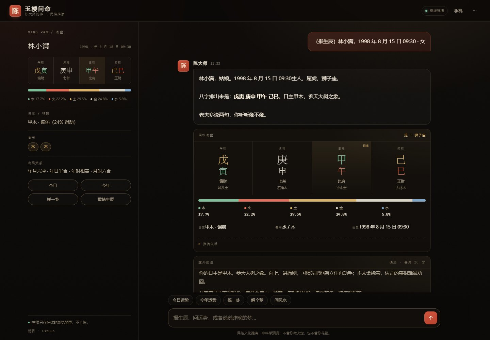
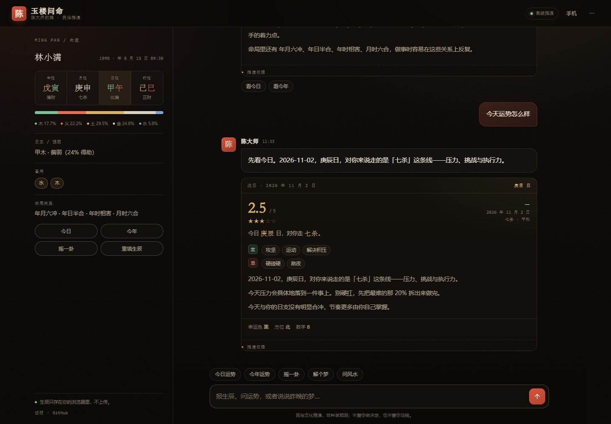
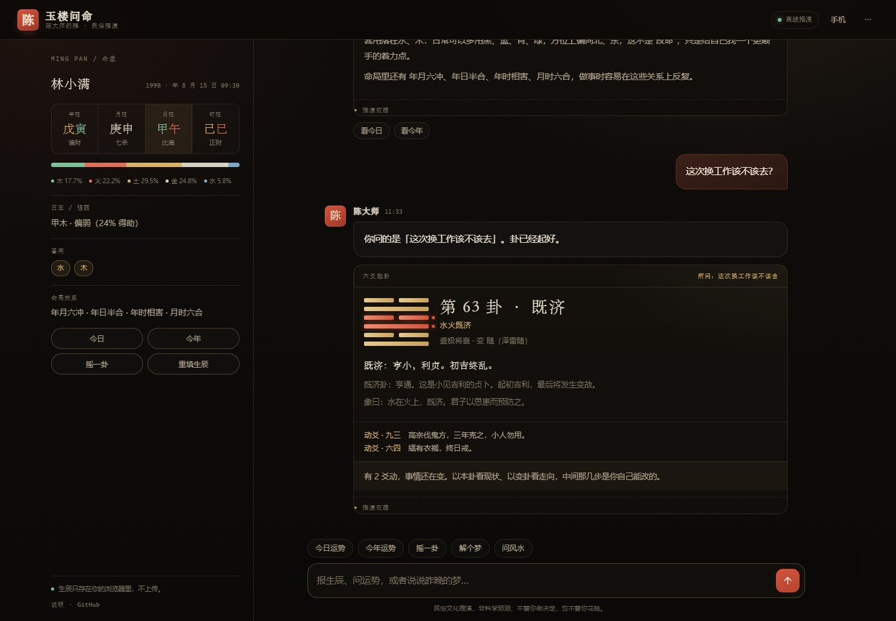
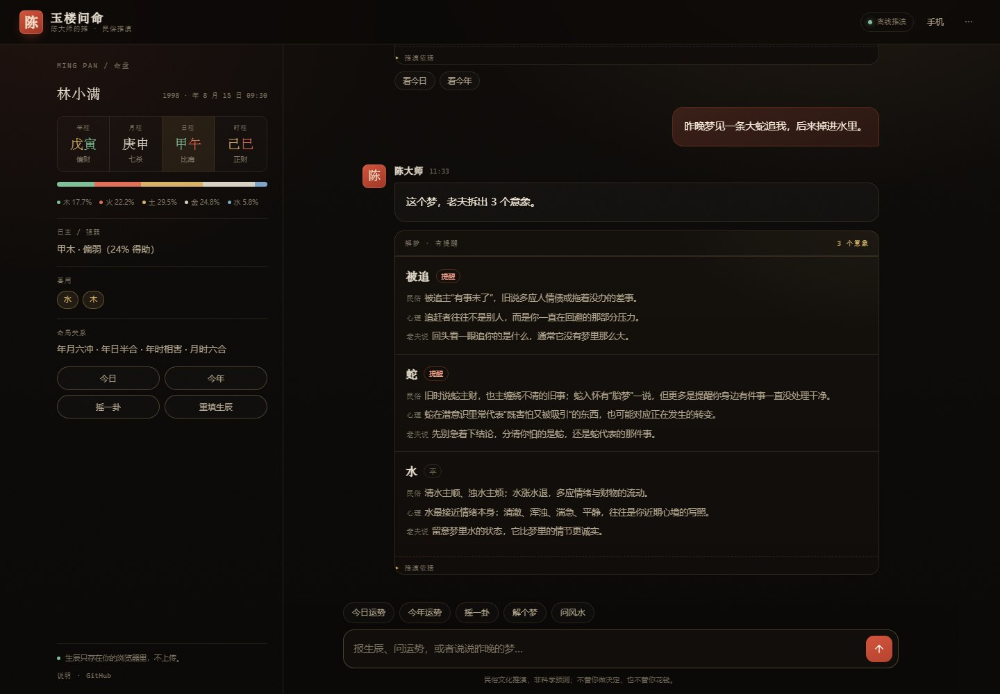
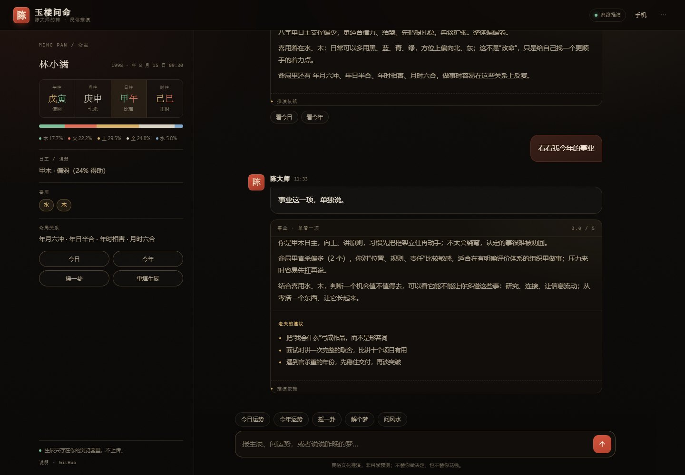
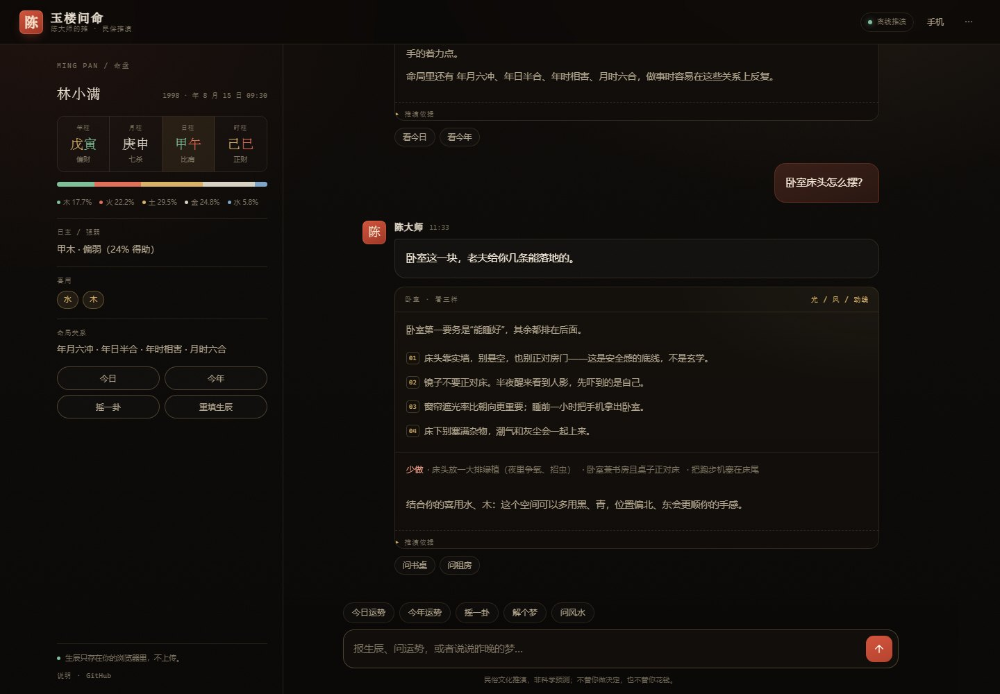
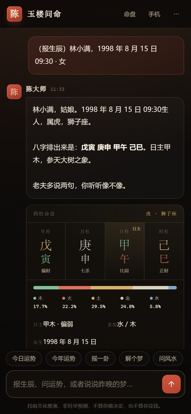

# 玉楼问命 · 陈大师的摊

一个能排八字、看流日流年、摇六爻、解梦、聊风水的民俗聊天机器人。

原生 HTML / CSS / JS，无框架、无构建、无第三方依赖。双击 `start.bat` 起一个本地静态服务就能用，手机连同一个 WiFi 扫码就能聊；不联网、不填 Key 也能完整推演。配置大模型之后，陈大师会把算好的结果说成“人话”。

> 民俗文化推演，不是科学预测。它不替你做医疗、法律、投资上的决定。



## 两个版本

| 目录 | 是什么 | 怎么跑 |
| --- | --- | --- |
| `legacy/` | 2025 年写的原始 LangChain Agent，**未改动** | 只作对照；依赖原环境（Redis / Qdrant / 原 Key） |
| `v1/` | 同一套 Agent 的兼容运行版：内存记忆、DeepSeek、本地库说明 | `start_v1.bat` 或 `python v1/server.py` |
| 根目录 | v2 产品版：零依赖前端推演 | `start.bat` 或 `python server.py` |

v1 证明的是“我会用代码把 Agent 配起来”：5 个工具、6 种情绪、Redis 记忆、FastAPI 接口。
v2 解决的是“别人怎么打开”：推演搬进浏览器，0 前端依赖，手机扫码就能聊。
两版都保留，案例页里也是按“旧版 → 迭代版”讲的。

## 30 秒跑起来

需要 Python 3.10+（只用来起一个静态服务，不装任何第三方库）。

```powershell
# 方式一：双击 start.bat

# 方式二：命令行
python server.py
```

浏览器会自动打开 `http://127.0.0.1:8787/`。手机访问：点右上角「手机」，用相机扫二维码（手机和电脑要在同一个 WiFi）。

也可以完全不启动服务、不走本地：把这个静态目录托管到任意静态服务器（作品集里嵌的就是这一版），推演功能一样可用，只是没有扫码入口，也不能接大模型。

> 为什么不建议直接双击 `index.html`：脚本用的是 ES Module，浏览器在 `file://` 下会按跨域策略拦截模块加载，页面会停在静态骨架。起一个静态服务（`start.bat` 或任意 `http.server`）即可。

## 接大模型（可选）

不填 Key 时，前端走本地规则；填了 Key，模型只负责把结构化结果“说成人话”，**数字、日期、干支、卦名都不允许改**。

```powershell
copy .env.example .env
# 编辑 .env，填入 LLM_API_KEY
python server.py
```

兼容任何 OpenAI 风格的 `/chat/completions`：

| 服务 | `LLM_BASE_URL` | `LLM_MODEL` |
| --- | --- | --- |
| DeepSeek | `https://api.deepseek.com/v1` | `deepseek-chat` |
| 智谱 | `https://open.bigmodel.cn/api/paas/v4` | `glm-4-flash` |
| Moonshot | `https://api.moonshot.cn/v1` | `moonshot-v1-8k` |
| OpenAI | `https://api.openai.com/v1` | `gpt-4o-mini` |

`.env` 已在 `.gitignore` 里，不会被提交。模型调用失败时，界面自动回退本地模式，不会卡住。

## 旧版 v1 怎么跑

v1 需要额外依赖（FastAPI + LangChain），第一次跑要装 2–3 分钟：

```powershell
# 双击 start_v1.bat（首次会自动建 .venv-v1 并安装依赖）

# 或手动
python -m venv .venv-v1
.venv-v1\Scripts\python.exe -m pip install -r v1\requirements-v1.txt
.venv-v1\Scripts\python.exe v1\server.py --port 8790
```

打开 <http://127.0.0.1:8790/>。Key 从 Windows 环境变量读取（`API_KEY_D` 或 `V1_OPENAI_KEY`），
详细说明和 6 处兼容修改见 [`v1/README.md`](v1/README.md)。

## 能做什么

| 能力 | 输入 | 输出 |
| --- | --- | --- |
| 排盘 | 公历生日、时辰、性别 | 四柱、十神、纳音、五行力量、日主强弱、喜用、命局合冲 |
| 流日 / 流年 | “今天运势怎么样” / “今年运势怎么样” | 1–5 分、十神主题、宜忌、幸运色/方位、太岁关系、关键月份 |
| 分项 | “今年事业怎么样” | 事业 / 财运 / 感情 / 健康，各自的规则依据与建议 |
| 六爻 | “摇一卦” → 选一路或直接问 | 六爻卦象、本卦/变卦、动爻、卦辞、白话、针对性解读 |
| 解梦 | “梦见一条蛇追我” | 命中意象、民俗说法、心理视角、一句建议 |
| 风水 | “卧室床头怎么摆” | 光 / 风 / 动线三条线，能落地的做法与“少做”清单 |

交互上的几个小设计：

- **一句话报生辰**：直接打“1998年8月15日 上午9点半 女”，不用先找表单；
- **表单只填一次**：生辰存在浏览器里，刷新还在；
- **推演依据可展开**：每个结论都能看到用了哪个流日、哪个十神、哪条合冲；
- **手机优先**：单列对话、底部输入、命盘抽屉、局域网二维码；
- **数据不出本机**：生辰与聊天记录只写 localStorage，可一键清空。

## 它是怎么算的

### 八字

- 年柱、月柱以**节气瞬间**为界（不是农历初一，也不是元旦）；
- 日柱按**子初换日**：23:00 起算次日，并把这个约定写在“推演依据”里；
- 时柱用五鼠遁：`((日干 % 5) * 2 + 时支) % 10`；
- 五行力量：天干计 1.0，地支藏干按本气 / 中气 / 余气加权，月令再乘 1.3；
- 日主强弱：同类（比劫 + 印）占比，>55% 偏强、<42% 偏弱；
- 喜用：偏弱取印比，偏强取食伤财，中和取最少的两个五行。

节气表由 `sxtwl`（寿星天文历）生成，覆盖 1900–2100，精确到秒，见 `assets/js/data/solar-terms.js`。八字回归样本 510 条，见 `tests/fixtures.json`。

### 流日 / 流年

流日十神 + 日支六合/六冲/相害/半合 + 喜用是否得助 + 一个按日期与命盘固定的微小扰动，加权成 1–5 分。评分是规则算的，不是“感觉”，每一条都能展开看依据。

### 六爻

三枚铜钱掷六次：6 老阴、7 少阳、8 少阴、9 老阳；老阴老阳为动爻，本卦翻动爻得变卦。卦辞、象辞、白话与分项解读来自公开的《周易》整理资料，见 `assets/js/data/hexagrams.js`。

### 解梦 / 风水

- 解梦是 40 个常见意象的词条匹配，每条都给“民俗说法 + 心理视角 + 一句建议”，不装作能断吉凶；
- 风水拆成“看光、看风、看动线”，民俗说法只作为补充，核心是环境心理与可执行的动作。

### 边界

- 时辰不确定时按午时估算，并在命盘上标注“（估）”；
- 强弱、喜用是简化模型，不追求命理界的流派之争；
- 所有页面常驻免责声明：不替代医生、律师、投资顾问；
- 不用“改运”“化解”之类的话术卖东西。

## 为什么把推演放在前端

第一版（见 `legacy/`）是 FastAPI + LangChain + Redis + Qdrant + 三个外部 API。能跑的时候很兴奋，但换一台电脑就打不开：Key 没了、Redis 没装、向量库路径不对。为了把这段经历展示出来，`v1/` 补了 6 处兼容修改，让它在没有 Redis 的机器上也能跑；原始文件仍留在 `legacy/` 作对照。

第二版换了一个判断：**这个产品的核心不是“接了哪个模型”，而是“我想算一卦的时候，30 秒内能不能打开”。**

所以：

- 推演规则放进前端，静态托管就能用，GitHub Pages 也能直接跑；
- 记忆从 Redis 换成 localStorage；
- 知识库从 Qdrant 换成结构化词条与节气表；
- Python 服务只保留两件事：托管静态文件、可选地代理大模型；
- 大模型从“唯一的大脑”降级成“可选的嘴”。

代价是推演逻辑变成了 JS、不能直接复用 Python 生态。但对这个产品来说，“打开就能用”比“技术栈统一”重要。

## 目录

```
yulou/
├─ index.html                 单页应用
├─ assets/
│  ├─ css/app.css             全部样式（墨底 / 朱砂 / 旧金 / 纸纹）
│  └─ js/
│     ├─ app.js               交互、意图路由、卡片渲染、localStorage
│     ├─ engine/
│     │  ├─ calendar.js       干支、节气、儒略日、纳音
│     │  ├─ bazi.js           四柱、五行、十神、强弱、喜用
│     │  ├─ fortune.js        流日 / 流年 / 分项
│     │  ├─ hexagram.js       六爻起卦、本卦变卦
│     │  ├─ dream.js          解梦匹配
│     │  ├─ fengshui.js       风水 / 居住建议
│     │  └─ persona.js        陈玉楼的人设与话术
│     ├─ data/                节气表、六十四卦、解梦词条
│     └─ vendor/qrcode.js     二维码（MIT）
├─ server.py                  静态服务 + 可选大模型代理（标准库）
├─ start.bat                  v2 · Windows 一键启动
├─ start_v1.bat               v1 · 首次自动装依赖并启动 Agent
├─ .env.example               大模型配置样例
├─ v1/                        2025 Agent 的兼容运行版（FastAPI + 展示页）
├─ legacy/                    2025 年的原始代码（未改动，不参与运行）
├─ tools/                     数据生成、截图、端到端检查
├─ tests/                     八字样本与引擎测试
└─ docs/                      截图
```

## 测试

```powershell
# 引擎：节气边界、子初换日、510 条八字样本、卦象、运势
node tests/engine.test.js

# 端到端：表单、意图路由、六爻、解梦、风水、持久化、手机抽屉、二维码
# 需要先启动 server.py，并安装 Edge
node tools/cdp-test.mjs
```

当前结果：引擎 223 项断言通过，端到端 26 项通过，浏览器控制台无报错。

## 部署与展示

线上展示用的是作品集仓库里的一份静态快照：<https://sky-code1.github.io/yulou/>（同目录 `SKY-code1/sky-code1.github.io/yulou/`）。

> 本仓库只放源码。如果在这里再开 GitHub Pages，地址同样是 `/yulou/`，会和作品集里的快照冲突——二选一即可。
> 想独立部署，建议把仓库改名为 `yulou-demo` 之类，再用 Settings → Pages 发布根目录。

没有服务端时，界面会自动隐藏“手机扫码”，其余功能不变。

## 数据与许可

- 节气：`sxtwl`（寿星天文历）生成；
- 六十四卦原文与白话：整理自 [liujuntao123/yijing](https://github.com/liujuntao123/yijing)（MIT）；
- 二维码：[qrcode-generator](https://github.com/kazuhikoarase/qrcode-generator)（MIT）；
- 其余代码与文案：MIT，© 2026 吴渊博。

## 截图

| 命盘 | 流日 |
| --- | --- |
|  |  |

| 六爻 | 解梦 |
| --- | --- |
|  |  |

| 分项 | 风水 |
| --- | --- |
|  |  |

<p align="center">
  
</p>
